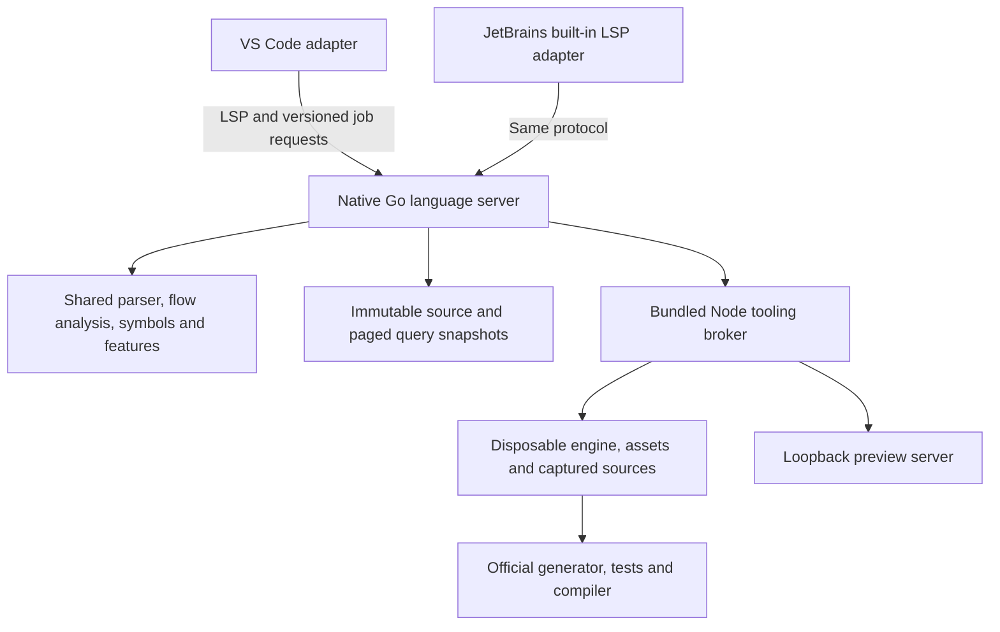

# Architecture

Both editors use the same native Go language server. TypeScript provides the shared tooling broker and editor-independent
protocol; Kotlin implements the JetBrains adapter. The earlier TypeScript analyzer remains in the repository for
regressions and comparison. Installed adapters select the bundled native server and do not automatically fall back to
partial analysis.

## Source boundaries

| Component                | Source                                                                                        | Responsibility                                                                         |
| ------------------------ | --------------------------------------------------------------------------------------------- | -------------------------------------------------------------------------------------- |
| Native core              | [`packages/core/src`](../packages/core/src) Go files                                          | Recovering parsing, flow, types, dialogue, semantic spans and feature queries          |
| Native server            | [`native/server`](../native/server)                                                           | LSP framing, project discovery, open buffers, revisions, scheduling and tooling bridge |
| Reference implementation | TypeScript in [`packages/core`](../packages/core) and [`packages/server`](../packages/server) | Earlier implementation and differential regression coverage                            |
| Protocol                 | [`packages/protocol/src`](../packages/protocol/src)                                           | Versioned DTOs, validation, coverage and Node runtime policy                           |
| Tooling                  | [`packages/tooling/src`](../packages/tooling/src)                                             | Staging, project creation, preview, official tools, export and process ownership       |
| Adapters                 | [`editors/vscode`](../editors/vscode), [`editors/intellij`](../editors/intellij)              | Editor lifecycle, presentation, actions, trust and theme mapping                       |
| Build                    | [`scripts`](../scripts), [`native/toolchain.json`](../native/toolchain.json)                  | Generation, native builds, provenance, runtime provisioning and packaging              |

Editor APIs stay in the adapters. Command metadata remains in
[`commands.json`](../packages/core/src/commands.json), which supplies generated help and fallback highlighting. The
unmodified pinned interpreter and its tests govern ChoiceScript runtime behavior.

## Complete analysis with compact storage

The parser distinguishes physical lines, indentation, commands, expressions and prose. Expression strings recover at
their own line boundary. Narrative dialogue has separate state that follows branches, jumps, scenes and subroutines.
Conditional siblings inherit the same incoming state; reachable exits merge. Uncertain types and dialogue remain
neutral rather than inventing certainty.

The native core represents long prose runs through exact transfer summaries while preserving source ranges, word counts,
quotation behavior and semantic spans. Commands and embedded expressions remain explicit. Control-flow analysis iterates
to a fixed point, including calls and loops. Environments use persistent shared structure and bounded exact memoization;
recycling clears memo entries that could otherwise retain invalid page handles.

Query snapshots retain definitions, references, inferred types, diagnostics and every semantic token. Repeating token
blocks can use a period and line stride only after comparing every field; irregular blocks retain their full values.
This is lossless storage compression. It does not skip scenes, lower analysis precision or drop highlighting spans.

Inactive query snapshots and lexical data can be paged to owned temporary files. Request leases keep a selected snapshot
alive through response encoding. Large semantic-token responses stream from that snapshot rather than allocating a
second complete JSON response. Switching projects waits for active readers before releasing their retained state.

## Source identity, versions and cancellation

Open sources use immutable file-backed captures and piece buffers. Text retention is bounded separately from line-offset
metadata. Disk identity, content digests, URI-local versions and project generations prevent an old result from becoming
current after edits, project removal or readdition. Aliases select the most recent source event; version numbers from
different URIs are not comparable.

Edits cancel superseded analysis. Restricted incremental paths update a snapshot only when their preconditions prove the
same full result; other changes run full project flow again. Byte-identical disk analysis can be reused on opening a
file, with diagnostics republished for the new open-document version. Explicitly selected loose files are analyzed
without treating neighboring text files as a game.

Requests wait for current analysis or return cancellation/freshness errors. Returning an error quickly does not satisfy
the interaction-latency requirement. [`indexStatus`](protocol.md) exposes complete project readiness independently of
scene counts. A failed full analysis is not replaced automatically with syntax-only or foreground-scene assistance.

## Official game tools

The native server lazily starts the bundled Node broker for tooling. The broker validates the
[versioned job request](protocol.md), captures open buffers, stages selected engine files and game assets, and runs the
pinned official generator, QuickTest, RandomTest or compiler in separate workers. A global child slot limits concurrent
heavy tools. Preview runs in the broker's loopback HTTP server.

Large scene inputs use immutable staged source pages and file-backed line offsets. The adapter implements the exact
source operations exercised by the pinned tools; it does not rewrite their interpreter or suppress legitimate engine
limits. Optional upstream caches are bounded and recomputed after eviction. A giant single physical line can still
require a large individual allocation.

Coverage uses lossless numeric chunks and bounded transport writes. Complete counts remain available while each editor
creates decorations only for visible lines. Export runs the unchanged compiler with staging-only hooks that spool its
scene JSON intermediate and stream the final HTML. Original regressions compare exact official output, including image
transforms, Unicode, CRLF, CRCs and labels.

Output backpressure bounds pending writes; raw output is saved to owned logs. Jobs retain captured source versions and
become stale after source or relevant asset edits. Preparation cancellation, active cancellation, preview restart,
project removal and server shutdown each settle owned jobs and clean up their processes. Shutdown closes the broker and
preview before acknowledging completion. Windows Job Objects and Unix process groups own descendants.

## Delivery and provenance

[`build-language-server.mjs`](../scripts/build-language-server.mjs) uses the pinned installed Go SDK, disables automatic
toolchain downloads and CGO, and records source, compiler, linker, binary and license hashes. Bundling rejects a native
artifact whose source digest or target is stale. Go is a build dependency; users do not need it installed.

VSIX files contain the selected target's native server and Node runtime. The universal JetBrains ZIP contains the six
locked target pairs; `--current` prepares only a host development bundle. Extraction verifies archive/native hashes and
restores executable permissions. JetBrains caches only the host native executable beside Node under a short name,
avoiding duplicate binaries and Windows executable-path limits. Node archives follow [`runtime-lock.json`](../runtime-lock.json); the selected engine
inventory follows [`runtime-files.json`](../vendor/runtime-files.json).

Legacy C/WASM and TypeScript sources remain available but are not the installed language-server path. Build/test SDKs,
IDE installations and private local reports are not plugin contents. See [development](development.md),
[performance](performance.md) and [release gates](releasing.md) for commands and the limits of current evidence.
