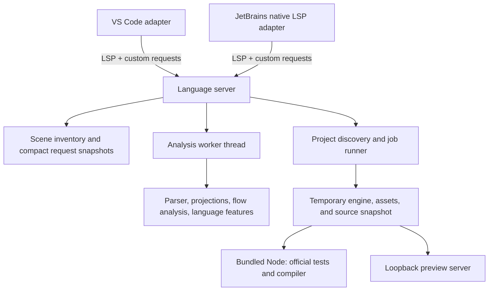

# Architecture

Bifoil ChoiceScript has one editor-independent TypeScript language core and tooling service, with a TypeScript VS Code
adapter and a Kotlin JetBrains adapter. Editor APIs belong in the adapters; syntax and control-flow semantics belong
in the shared packages.

This describes the implemented design. Resource limits and lifecycle defects are documented in
[performance](performance.md) and [known limitations](known-limitations.md); the diagram is not a guarantee of bounded
memory or successful cleanup on every path.

## Package boundaries

| Component     | Source                                              | Owns                                                                                  |
| ------------- | --------------------------------------------------- | ------------------------------------------------------------------------------------- |
| Core          | [`packages/core/src`](../packages/core/src)         | Parsing, flow, abstract values, symbols, diagnostics, semantic spans, feature queries |
| Server        | [`packages/server/src`](../packages/server/src)     | LSP, open buffers, revisions, indexing, worker scheduling, publication                |
| Protocol      | [`packages/protocol/src`](../packages/protocol/src) | Shared DTOs, option validation, coverage state, runtime policy                        |
| Tooling       | [`packages/tooling/src`](../packages/tooling/src)   | Discovery, creation, staging, preview, official jobs, process ownership               |
| VS Code       | [`editors/vscode`](../editors/vscode)               | Client lifecycle, association, commands, progress, webviews, theme mapping            |
| JetBrains     | [`editors/intellij`](../editors/intellij)           | Native LSP integration, substitution, actions, tool window, JCEF, colors              |
| Build scripts | [`scripts`](../scripts)                             | Generation, engine verification, bundling, runtime provisioning, packages             |

## Parsing and abstract interpretation

`parser.ts` builds an indentation tree from physical lines. `expression.ts` parses command expressions and recovers
unterminated strings at line boundaries. Narrative quotation is a separate state used by `analysis.ts`.
`environment.ts` and `worklist.ts` support value environments and analysis scheduling.

Control-flow nodes represent executable structure rather than reading all source as one uninterrupted passage.
Conditional siblings share their entry state; joins combine reachable exits. Calls use context summaries and
subscribers. Loops and recursive calls iterate toward a fixed point with a finite work budget.

Abstract values track possible types and retain constants where justified. Assignment, scope changes, array bindings,
dynamic destinations, and generated text can widen that information. Unknown values receive neutral styling.
These operations must not execute source code to infer runtime values.

The result contains document models, semantic spans, diagnostics, symbols, references, inferred values, and word counts.
`features.ts` exposes completion, hover, navigation, rename, symbols, folding, and selections over that result.
`spans.ts` combines narrative with code/markup overlays without overlapping LSP tokens.

The [language guide](specification.md) is the user-visible model. The pinned runtime and focused differential
regressions
remain necessary checks of that model.

## Compact scenes and request snapshots

Retaining every line of a huge game as a full syntax tree is expensive. The server therefore separates:

1. A scene inventory: identities and filesystem information.
2. Full source for open/foreground scenes.
3. Compact projections for closed scenes.
4. Compressed request indexes used by interactive queries.

`projection.ts` summarizes eligible prose runs with source extents, word counts, and dialogue transfer information.
Commands, expressions, interpolation, and control flow remain explicit where required.
A projected document can have sparse physical lines; consumers must use its lookup helpers rather than assuming
`document.lines[n]` means source line `n`.

`scene-index.ts` owns a temporary directory of compressed scene summaries and a process-wide 8 MiB compressed cache.
The worker loads closed scenes incrementally. `snapshots.ts` provides compact indexes for lines, tokens, and references. These let the
server respond without receiving the full analysis graph for every response.

This reduces retained prose, but command-heavy games and open giant files still impose substantial costs.
The cache size does not bound every allocation, decoded tree, open buffer, or job snapshot.

## Scheduling, versions, and invalidation

The server owns one warm analysis worker for the active game. Unchanged projected syntax and request indexes can be
reused. Switching active games or superseding busy work retires a worker; shutdown is awaited before replacement to
avoid overlapping live workers.

Source stamps, content fingerprints, open-buffer versions, and project generations determine whether results are
current. Edits invalidate the affected game while independent games retain their snapshots.
A restricted plain-prose edit can update a request index directly when its line structure and semantic state are
unchanged. Quotes, commands, interpolation, markup, and other structural changes require broader analysis.

Initial indexing is incomplete context. Incoming quotation may be unknown, some contextual warnings are deferred,
and complete-project references/rename must wait. `choicescript/indexStatus` exposes readiness separately from the
number of cached scenes.

Interactive requests wait briefly for a current snapshot and support cancellation. If analysis does not become
available within the request budget, the server can return `ContentModified` instead of a useful result.
That prevents pretending an obsolete answer is current; it does **not** satisfy the latency acceptance requirement.

Filesystem notifications and adapter watches participate in invalidation. Known gaps around external roots,
directory-only changes, and retained job history are documented rather than assumed solved.

## Game-job lifecycle

The server forwards a [versioned job request](protocol.md) after checking project selection, options, and editor trust.
The runner allocates a job ID, emits lifecycle events, captures scene buffers, prepares a temporary engine/game tree,
then starts preview or an official tool.

The runtime inventory in [`vendor/runtime-files.json`](../vendor/runtime-files.json) selects unmodified engine files.
Disk scene copying checks for concurrent changes; open buffers are written from the captured version.
Assets come from disk through the copy filter.

Generator/test/compiler children share a global process slot, with per-project ordering for starts.
Preview is an HTTP server in the server process, not another ChoiceScript analysis worker.
Output parsing maps trusted runner locations to scene URIs, collects coverage, saves logs, and emits completion.
Edits mark the originating job stale.

The pinned compiler expects a `rootDir` global in its VM-loaded generator. Export supplies a temporary preload inside
staging; it does not patch upstream source.

Disposal attempts to stop direct child processes, close preview servers, remove owned staging/index directories, and
settle jobs. Treat those as lifecycle obligations to test, especially failure and cancellation paths, rather than
assuming
the happy path proves cleanup.

## Adapter responsibilities

Both adapters consume the same semantic-token legend and diagnostics. They map presentation to editor themes, expose
commands and trust decisions, and display output/coverage.

VS Code uses `vscode-languageclient` and a webview. JetBrains uses the platform's built-in LSP infrastructure and
LSP4J-backed custom messages. Direct DTO/helper tests do not replace exercising native transport and lifecycle.
See [JetBrains notes](jetbrains-api-notes.md).

Fallback grammars are generated or maintained from shared command categories. They stay line-local; adapters must not
invent separate branch-dependent dialogue analysis.

## Distribution boundary

The build verifies the engine submodule revision and file hashes before copying the selected runtime.
Node archives are pinned and checked by [`runtime-lock.json`](../runtime-lock.json).
VSIX files contain one target runtime. A release JetBrains ZIP contains all six; host-only development preparation does
not.

The native adapter verifies bundled archives before extraction into IDE caches. IDE SDKs and JetBrains Runtime are
build/test dependencies, not plugin contents.
[Third-party notices](../THIRD_PARTY_NOTICES.md) travel with distributions.
See [development](development.md) for generated paths and [releasing](releasing.md) for artifact boundaries.
