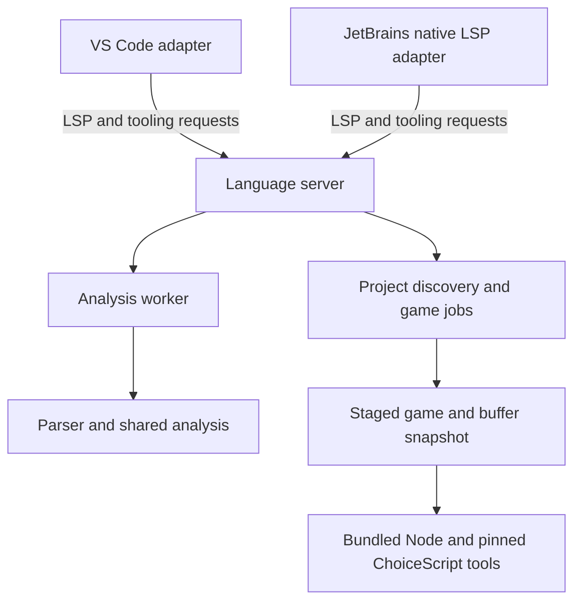

# Architecture

Branchlight has one TypeScript language service and game-tooling implementation, with adapters for VS Code and JetBrains IDEs. Editor-specific code handles integration and presentation; syntax and analysis do not depend on either editor's APIs.

## Components

| Component         | Source                      | Responsibility                                                                     |
| ----------------- | --------------------------- | ---------------------------------------------------------------------------------- |
| Language core     | `packages/core/src`         | Syntax trees, symbols, control flow, diagnostics, semantic spans, editing features |
| Language server   | `packages/server/src`       | LSP transport, workspace state, snapshots, analysis scheduling                     |
| Shared protocol   | `packages/protocol/src`     | Versioned game-tool contracts                                                      |
| Game tooling      | `packages/tooling/src`      | Discovery, staging, preview, tests, export, process ownership                      |
| VS Code adapter   | `editors/vscode/src`        | Client lifecycle, commands, associations, webview, theme mapping                   |
| JetBrains adapter | `editors/intellij/src/main` | Native LSP, language substitution, actions, JCEF, color settings                   |

## Parsing and analysis

The parser builds an indentation tree from physical lines. Expression tokenization recovers at line boundaries, while narrative quotation uses a separate abstract state propagated through a control-flow graph. This separation prevents an incomplete command string from corrupting later prose.

Conditional alternatives share an incoming state. Joins combine reachable states; dialogue styling requires agreement. Calls use context-indexed summaries and subscribers, with a worklist that converges across loops and recursion. Abstract variable values preserve constants when paths agree and become less precise when assignments or dynamic operations require it.

The source model uses UTF-16 offsets. Semantic spans are split at overlay boundaries so expression and markup tokens take precedence over narrative without overlapping. Shared command metadata also generates conservative editor fallbacks. Those fallbacks do not implement cross-line dialogue analysis.

See [language behavior](specification.md) for the user-visible contract. The analyzer does not run game code to discover values; official runtime tests complement static analysis.

## Snapshots and cancellation

The server combines project files with open document buffers into versioned snapshots. Analysis runs in a worker. Superseding work terminates an obsolete worker, and only results for the current revision are published.

Project membership and dependency changes invalidate analysis. The adapters receive the same diagnostics and semantic classifications; each maps them to its editor's UI and theme system.

## Game jobs

The tooling layer copies the pinned engine, relevant game assets, and scene buffers into a disposable staging directory. It excludes engine Git metadata. Official QuickTest, RandomTest, and compilation run as child processes using the bundled Node executable, independently of the analysis worker.

Preview serves the staged web root over loopback with a per-run URL token. It preserves the current playthrough until an explicit restart. Job events carry output, mapped scene locations, coverage where available, staleness, and completion. Logs survive under the game root; owned staging directories and processes are cleaned up when jobs stop.

The pinned compiler's VM-loaded generator expects a global `rootDir`. Export supplies it through a staging-only Node preload. The upstream source remains unchanged; an integration test covers this compatibility bridge.

The [protocol reference](protocol.md) documents requests and events. Trust decisions originate in the editor; the server/tooling layer also checks execution requests. Language assistance remains available without execution trust.

## Packaging boundaries

The engine is an unmodified Git submodule checked against its recorded revision and per-file hashes before a build. Node archive versions and hashes are recorded in `runtime-lock.json`. Each VSIX contains its target runtime; the distribution JetBrains ZIP contains all six. The native adapter verifies and extracts its bundled resources into the IDE cache.

The IDE SDK and JetBrains Runtime are build/test dependencies, not contents of the plugin. Dependency licenses and provenance accompany packaged outputs. See [third-party notices](../THIRD_PARTY_NOTICES.md) and [packaging](releasing.md).
